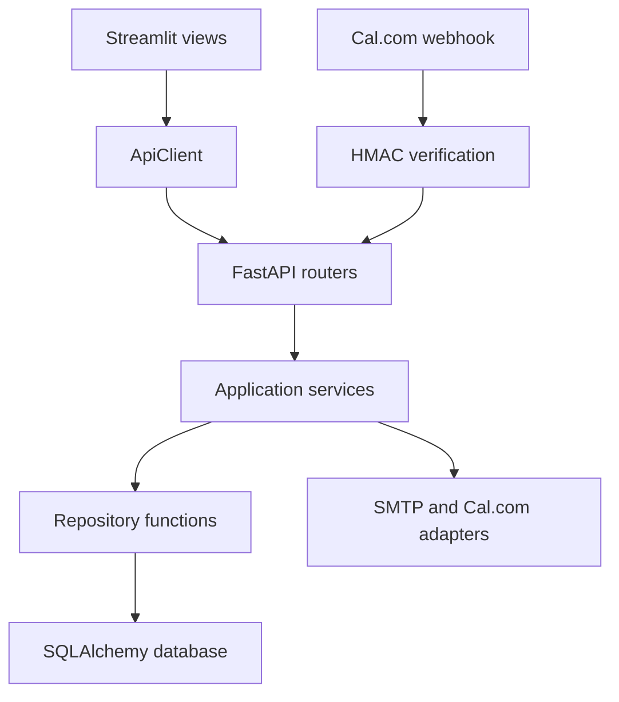

# 01. Стратегия и порядок реализации

Статус: **предложено к реализации**. Базовый коммит: [`df20603afe7b9dcfc59a2d56d6442d0c575c8921`](https://github.com/Vlad-Morozkov/HR_Integration_Project/commit/df20603afe7b9dcfc59a2d56d6442d0c575c8921).

## 1. Методология для этого проекта

Выбран **инкрементальный рефакторинг модульного монолита**. Из Strangler Fig используем постепенное замещение участков за сохранёнными интерфейсами; из Mikado — небольшие эксперименты для обнаружения зависимостей и выполнение необходимых подготовительных шагов. Это применение принципов к существующему Python-приложению, а не требование строить дополнительный сервис или прокси. Основания: [Fowler](https://martinfowler.com/bliki/StranglerFigApplication.html), [правила авторов Mikado](https://livebook.manning.com/book/the-mikado-method/chapter-3).

Рабочий цикл одного изменения:

1. Выбрать один сценарий или одну границу: например, отправка письма после найма.
2. Написать/проверить тест наблюдаемого поведения: HTTP, БД, внешние вызовы.
3. Сделать небольшой перенос без изменения бизнес-правил.
4. Если выяснилась зависимость, записать её и вернуть только свой эксперимент; сначала выполнить предшествующий шаг. Не применять `reset --hard` к папке с чужими локальными правками.
5. Проверить затронутые сценарии, просмотреть diff и сделать отдельный коммит/PR.
6. Удалить старую реализацию после переключения всех её потребителей.

**Различать два вида тестов.** Characterization фиксирует фактическое поведение для безопасного переноса. Regression test для исправления задаёт желаемое поведение и сначала воспроизводит ошибку. Ошибки RU-навигации, конкурентного найма или компенсации не объявлять постоянными требованиями только потому, что так работает baseline.

Для текущего объёма достаточно узких модулей и явной передачи зависимостей. Generic repository, отдельная шина событий, Celery/Redis, микросервисы и полный DDD пока не имеют подтверждённой задачи. Их стоимость следует оценивать при появлении конкретной нагрузки или требования надёжности.

## 2. Что проверено в исходниках

| Участок | Проверенное состояние | Следствие для плана |
| --- | --- | --- |
| [`main.py`](https://github.com/Vlad-Morozkov/HR_Integration_Project/blob/df20603afe7b9dcfc59a2d56d6442d0c575c8921/main.py) | 1 872 строки, 15 маршрутов; HTTP, настройки, SQLAlchemy, SMTP, Cal.com и demo в одном модуле | Выделять по рабочим сценариям с сохранением входных/выходных контрактов |
| [`frontend.py`](https://github.com/Vlad-Morozkov/HR_Integration_Project/blob/df20603afe7b9dcfc59a2d56d6442d0c575c8921/frontend.py) | 2 752 строки; 12 прямых вызовов requests, помимо ApiClient | Сначала унифицировать HTTP-границу, затем дробить UI |
| [`api_client.py:28–90`](https://github.com/Vlad-Morozkov/HR_Integration_Project/blob/df20603afe7b9dcfc59a2d56d6442d0c575c8921/api_client.py#L28-L90) | Уже есть клиент для email/status/create position, но он зависит от Streamlit и глобального ключа | Использовать существующую точку расширения; передавать конфиг явно |
| `main.py:64`, `frontend.py:46`, `api_client.py:17` | Один опубликованный резервный INTERNAL_API_KEY в трёх местах | Ротация и удаление всех fallback; фактический ключ хостинга может отличаться |
| [`models.py:15–28`](https://github.com/Vlad-Morozkov/HR_Integration_Project/blob/df20603afe7b9dcfc59a2d56d6442d0c575c8921/models.py#L15-L28) и `main.py:763–807` | Проверка активной заявки есть в Python; уникального ограничения active(email, position) в моделях нет | SELECT перед INSERT не гарантирует отсутствие дублей при гонке; нужна отдельная DB-задача |
| `main.py:901–934` | Найм меняет статус и занятость в одном commit; `force=True` допускает занятую позицию | Сохранить семантику force; конкурентную защиту проектировать под неё |
| `main.py:79,421–447,1565–1754` | SYSTEM_LOCKED — глобальная переменная; middleware также блокирует webhook POST | Перенос в класс сам по себе не решает атомарность, несколько процессов и события во время reset |
| `main.py:1102–1231,1436–1558` | Booking разбивается на 30 минут; компенсация покрывает не все виды ошибок | Отдельно обработать неизвестный результат, missing UID, commit failure и неудачную отмену |
| `frontend.py:277–304,340`, `translations.py:227` | `mode='Candidate'` сравнивается с переведённым `t['candidate']` | В RU выбирается неверная ветка; отдельный regression test и исправление до UI extraction |
| [`main.py:400`](https://github.com/Vlad-Morozkov/HR_Integration_Project/blob/df20603afe7b9dcfc59a2d56d6442d0c575c8921/main.py#L400) | `create_all()` выполняется при импорте | Тесты должны изолировать БД до импорта; schema init затем заменить явной командой миграции |
| [`test_validators.py`](https://github.com/Vlad-Morozkov/HR_Integration_Project/blob/df20603afe7b9dcfc59a2d56d6442d0c575c8921/test_validators.py) | 11 простых тестовых функций; API/интеграций/UI тестами не покрыты | Текущих проверок недостаточно для переноса правил найма и календаря |
| [`.gitattributes`](https://github.com/Vlad-Morozkov/HR_Integration_Project/blob/df20603afe7b9dcfc59a2d56d6442d0c575c8921/.gitattributes) | Вместо Git attributes содержит Python-код страницы About; Git выводит warnings | Восстановить назначение файла отдельным подготовительным коммитом |
| [`REstart_hr.bat:4`](https://github.com/Vlad-Morozkov/HR_Integration_Project/blob/df20603afe7b9dcfc59a2d56d6442d0c575c8921/REstart_hr.bat#L4) | `taskkill /F /IM python.exe` завершает все процессы Python | Заменить управлением PID именно проекта; не использовать этот скрипт для тестов |

DeepWiki хорошо выделил основные связи. Уточнения выше получены из кода: наличие обработки `IntegrityError` ещё не доказывает наличие ограничения в БД, а «rollback» внешних бронирований не равен SQL rollback. `TechRev.md` и ProjectContext тоже сверять с кодом и тестами; они не являются единственным источником фактов.

## 3. Целевая структура

Структура ниже — ориентир по ответственности, а не требование создать все пустые файлы в первом PR. Корневые модули оставлять совместимыми обёртками на время переноса.

```text
main.py                         # совместимый экспорт app
frontend.py                     # настройка Streamlit и сборка интерфейса
app/
  factory.py                    # create_app и подключение router/dependencies
  config.py                     # backend settings, явное чтение при запуске
  security.py                   # INTERNAL_API_KEY, HMAC helpers
  database.py                   # engine/session factory/get_db
  schemas.py                    # текущие request/response модели
  models.py                     # ORM; сначала можно оставить в корне
  routers/
    positions.py
    applications.py
    interviews.py
    webhooks.py
    demo.py
    system.py
  services/
    applications.py             # create/update email
    hiring.py                   # transition + граница транзакции
    interviews.py               # сценарии booking/cancel
    demo.py                     # reset/seed orchestration
    maintenance.py              # протокол блокировки, отдельная задача
    retention.py                # политика очистки интервью
    webhooks.py                 # обработка проверенных событий
  repositories/
    applications.py             # только необходимые запросы, без commit
    positions.py
    interviews.py
  integrations/
    email.py                    # SMTP adapter
    calcom.py                   # HTTP adapter, договорённости Cal.com
  demo_data.py                   # фикстуры demo
  normalization.py               # общая нормализация данных
  time_utils.py                  # преобразования времени
api_client.py                   # чистый HTTP-клиент, без import streamlit
ui/
  config.py
  bootstrap.py                  # создание клиента из настроек
  context.py                    # язык и часовой пояс
  actions.py                    # действия UI через ApiClient
  state.py
  navigation.py
  data.py                       # cache/invalidation wrappers
  views/
    candidate.py
    hr.py
    about.py
  components/
    application_table.py
    hiring_actions.py
    interview_calendar.py
    candidate_bookings.py
    demo_status.py
    positions.py
tests/
  unit/
  api/
  integration/
  ui/
alembic/                        # только на этапе введения миграций
docs/
```

`email_service.py` из DeepWiki разделяется по назначению: технический SMTP — в `integrations/email.py`, решение кому/когда отправлять — в прикладном сценарии. Для Cal.com действует то же правило. Названия допустимо адаптировать, сохраняя одну ответственность на модуль.

**Направление зависимости:** router знает сервис и схемы; сервис знает узкие запросы и интерфейсы интеграций; SQLAlchemy/HTTP/SMTP находятся на внешней границе. UI знает ApiClient, а ApiClient не знает Streamlit. Сервису не нужны `st.*`, `Request` или глобальная конфигурация. Domain errors можно начать с нескольких простых exceptions, без иерархии ради иерархии.



FastAPI поддерживает разбиение через `APIRouter` и зависимости; маршруты не требуют отдельных процессов: [официальный пример](https://fastapi.tiangolo.com/tutorial/bigger-applications/).

## 4. Последовательность небольших PR

Каждый этап может занимать несколько небольших PR. Зависимость означает минимальную готовность границы, а не необходимость дождаться всего последующего этапа. Тесты добавляются вместе с первой затрагиваемой операцией, а не отдельной большой фазой «после рефакторинга».

| Этап | Места и изменения | Зависит от | Проверка приёмки / откат |
| --- | --- | --- | --- |
| P0: baseline | `.gitattributes`, `requirements.txt`, тестовое окружение, команды запуска; учесть локальный `.gitignore`/Plan | Эта документация | Исходный код воспроизводим, нет Git warnings; записаны версии; отдельный revert подготовительного коммита |
| P1: secret boundary | Три fallback, `app/config.py`, `app/security.py`, `ui/config.py`, `.env.example`, `.gitignore` | Минимальный тестовый запуск P0 | Новый ключ работает, старый/пустой/отсутствующий — 401; отсутствие обязательного ключа останавливает запуск. Откат кода не должен вернуть опубликованный ключ |
| P2: characterization | `tests/api`, `tests/integration`, fixtures, sanitized OpenAPI | Изоляция P0; auth tests в P1 | Зафиксированы ответы/ошибки и DB/внешние эффекты; сетевые вызовы тестов запрещены |
| P3: infrastructure | `main.py:374–400,453–552`, дополнительные схемы :84,:215,:232,:620 → config/database/schemas; app factory | P1 + нужные P2 | Состав 15 routes, схемы, HTTP-коды и точки входа совпадают; отдельно учитывать изменения operationId |
| P4: adapters | `send_email`, `cancel_calcom_booking`, HTTP из booking и demo → integrations | P2 + P3 | Те же payload/header/version/timeout; нет реальных отправок; прежняя обработка внешних отказов сохранена |
| P5: use cases | `create_application`, status/email updates, booking/cancel, prune/demo → services и нужные query functions | P2 + P4 | Один владелец commit/rollback; письма остаются после commit; force, конфликты и флаги ответа сохранены |
| P6: routes | Декораторы и HTTP-валидация → app/routers; `main.py` совместимый export | P5 | Auth не потеряна, webhook не требует INTERNAL_API_KEY; все пути и response models проверены |
| P7: frontend HTTP | `api_client.py`, 12 прямых requests в `frontend.py` | P1 + client contract tests P2 | Все вызовы через ApiClient; ошибки 401/409/503/422 и timeout различимы; политика повторов явная |
| P8: frontend modules | `frontend.py`, `ui_about.py`, translations, timezone component → ui/views/components | P7 + F1 | RU/EN Candidate/HR/About, calendar, forms и rerun проверены; sidebar — отдельное изменение |
| P9: schema lifecycle | `create_all`, `models.py`, Alembic baseline/release procedure | P3 + DB tests P2 | Пустая и существующая БД обновляются проверенным путём; после этого import/startup не выполняет DDL |
| P10: delivery cleanup | Удаление совместимых лишних обёрток, документация команд, CI | Готовые части P3–P9 | Smoke в тестовой среде; читаемый diff; известные ошибки явно учтены, необоснованных xfail нет |

P3 не должен незаметно удалять создание схемы до появления безопасного заменяющего сценария: сначала изолировать побочный эффект и протестировать запуск, затем удалить его в P9. До P9 тесты задают временную БД до импорта. Не смешивать перенос ORM-файла со сменой схемы и обновлением SQLAlchemy.

## 5. Отдельные исправления поведения

| ID | Проблема / решение | Когда делать | Доказательство результата |
| --- | --- | --- | --- |
| F1 | RU Candidate: стабильные внутренние значения mode, перевод только для отображения | После минимального UI-теста, до P8 | RU Candidate действительно открывает форму кандидата; смена языка сохраняет режим |
| F2 | Дубли/найм/email: атомарные условия записи и partial unique index под New/Hired | После P2 и P9, желательно до release с конкурентными пользователями | Два параллельных запроса дают один согласованный результат; `force=True` по-прежнему действует осознанно |
| F3 | Cal.com: неизвестный результат create, неполная компенсация, удаление UID при failed cancel | После P4, по частям | Неудача любого шага оставляет сведения для сверки; повтор не создаёт booking автоматически |
| F4 | Reset: повторный запуск, уже начавшиеся writers, webhook во время reset, process-local flag, ложный успех UI | После contract tests; отдельный дизайн совместно backend/frontend | Двойной reset отклоняется атомарно, ошибки видны; нет необратимо потерянных событий/UID |
| F5 | Время: reschedule с offset и `.replace(tzinfo=None)`, отрицательные/некратные окна, DST | После tests + P4 | Один и тот же момент времени сохраняется во всех путях, окна валидируются до внешнего POST |
| F6 | Служебный запуск: завершение всех Python и фиксированное ожидание 3 секунды | Небольшой независимый PR после P0 | Перезапуск затрагивает только HR-процессы, readiness подтверждается безопасной проверкой |

В F2 не вводить безусловный `UNIQUE(email, position_id)`: он может запретить предусмотренную повторную заявку после `Canceled`. В F4 новый асинхронный job API с 202/job_id потребует совместного изменения клиента и документации; это не механический перенос текущего reset с HTTP 200.

## 6. Совместимость, выпуск и откат

- Сохранить `uvicorn main:app` и `streamlit run frontend.py` до проверки реальных конфигураций запуска. Корневой `main.py` затем может содержать `from app.factory import create_app; app = create_app()` — в двух обычных строках.
- Сохранять пути, методы, статусы, формы `detail`, флаги email в ответе, `Canceled` и поведение force. Изменения operationId/schema оформить явно, если они понадобятся.
- Переходный wrapper допускается на короткий срок; нельзя оставлять две активные реализации одного правила с расходящейся логикой.
- После каждого PR запускать релевантные unit/API tests; PostgreSQL concurrency и migration tests — для задач БД, AppTest/manual browser smoke — для UI.
- Реальные бронирования и письма не использовать для доказательства безопасности механического переноса. Проверка в sandbox внешнего сервиса — отдельная smoke-процедура.
- Обычный код откатывается revert соответствующего коммита. Миграция откатывается только после проверки сохранности данных/совместимости; удалённые bookings нельзя восстановить `git revert`.
- Для секретов допустим только безопасный откат, который продолжает использовать новый непубличный ключ. Возвращение скомпрометированного значения не является способом восстановления.

## 7. Что не следует смешивать с этой работой

Обновление Python и всех библиотек, новый дизайн sidebar, смена Streamlit на SPA, новые статусы/правила найма и полный перенос deployment — независимые проекты. Сначала зафиксировать работающие версии, затем менять по одной причине. Не обещать дату окончания до измерения первых этапов: наиболее неопределённая часть — согласованность внешнего календаря и существующей БД, а не разнос файлов по каталогам.

Подробности реализации и проверок: [02](02-configuration-and-secrets.md), [03](03-backend-and-integrations.md), [04](04-frontend-and-api-client.md), [05](05-testing-and-delivery.md). Основания и непроверенные runtime-факты: [06](06-sources-and-decisions.md).
